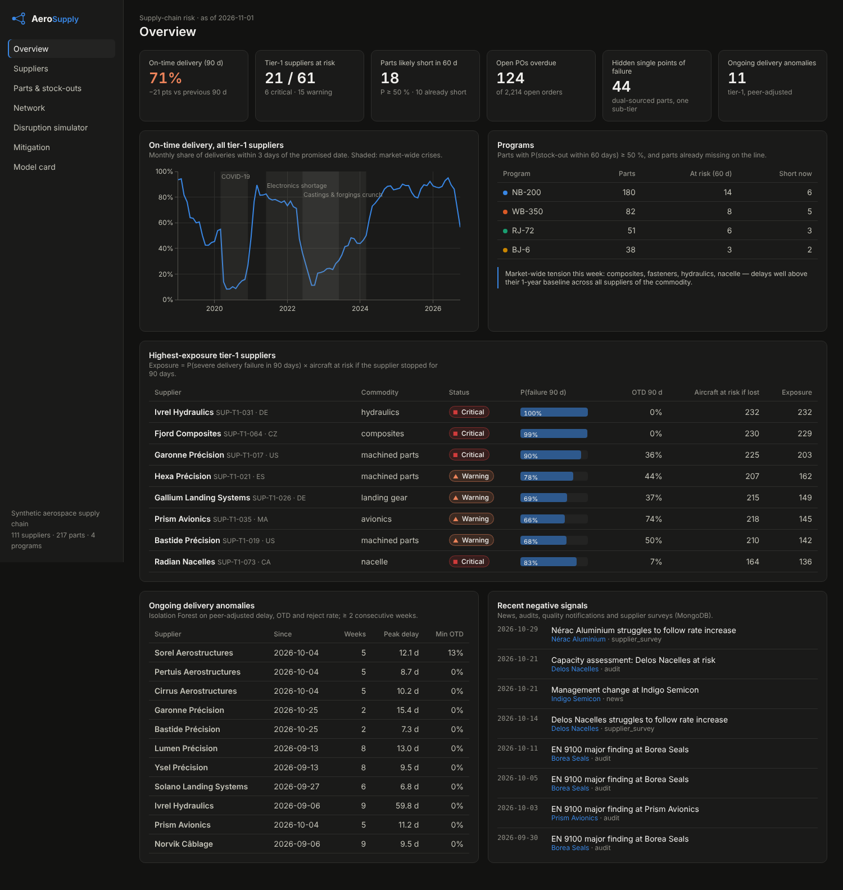
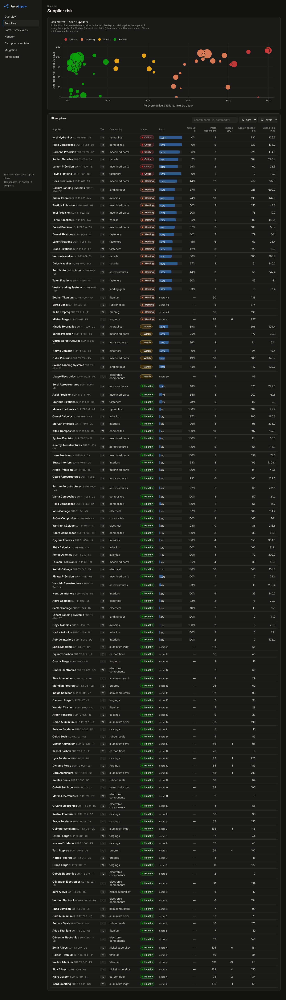
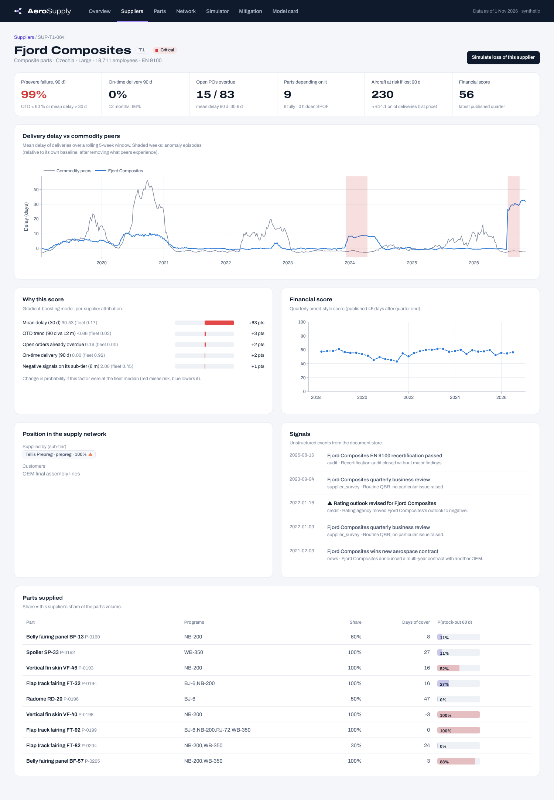
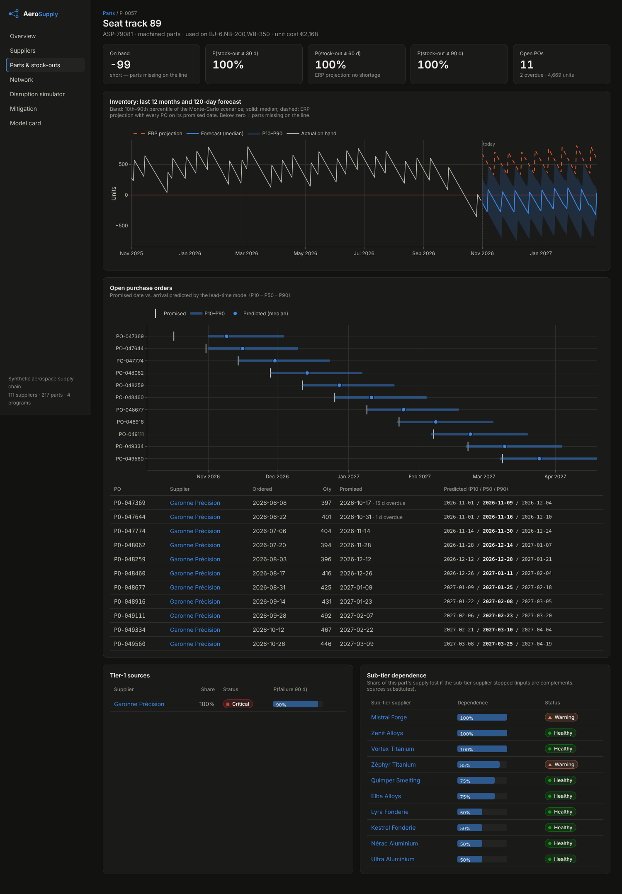
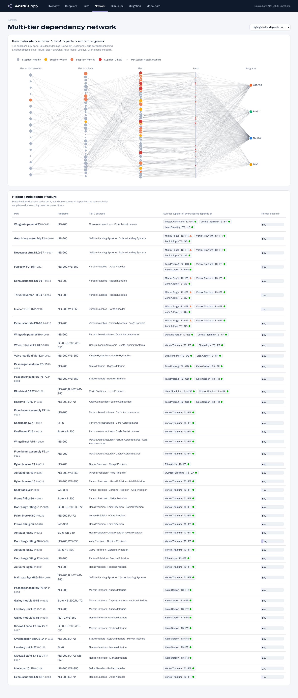
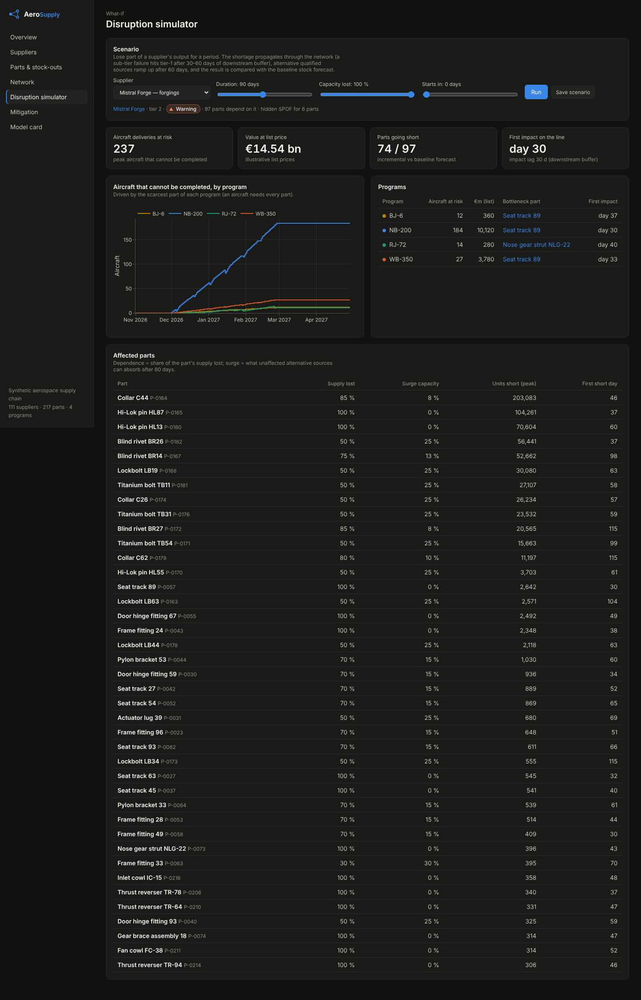
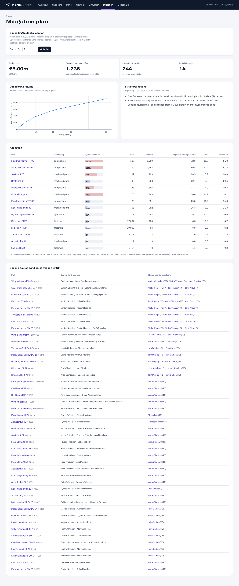
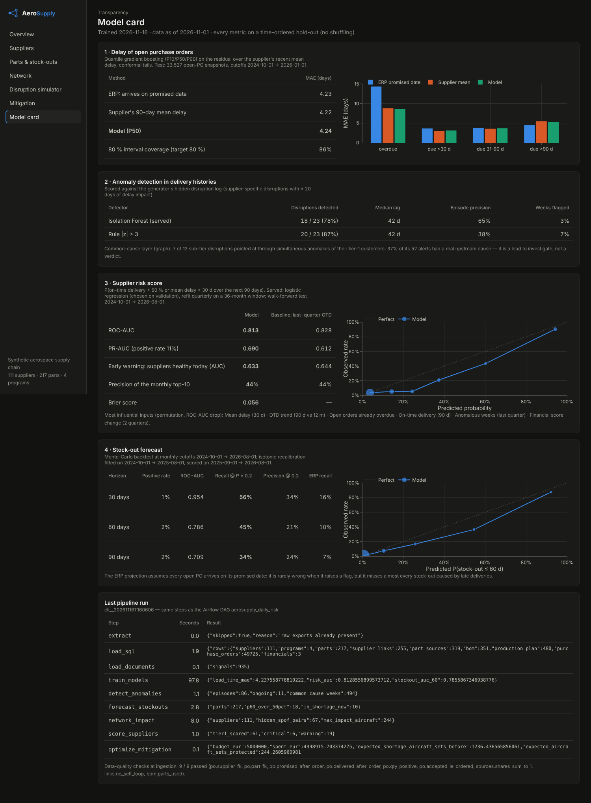

# AeroSupply — Supply-chain risk intelligence for aerospace manufacturing

A platform that answers the question every aircraft programme asks each morning: **which supplier
is about to slip, which part will be missing on the assembly line, and how many aircraft does it
put at risk?** It scores tier-1 suppliers, detects abnormal delivery behaviour, maps the multi-tier
dependency network down to raw materials, forecasts stock-outs from the open order book and
simulates what happens if a supplier stops.

**Live demo: https://stevvvvvv.github.io/AeroSupply/**
(static version: the real pipeline's outputs frozen on 1 Nov 2026; what-if scenarios and budgets pre-computed on a grid)



| | |
|---|---|
| **Data architecture** | PostgreSQL (master & transactional data, keyed schema) · MongoDB (news / audit / quality signals, risk snapshots, saved scenarios, run log) · data-quality checks at ingestion |
| **Orchestration** | Apache Airflow 3 DAG `aerosupply_daily_risk` (9 tasks), generated from the same step list as the CLI |
| **ML** | scikit-learn: quantile gradient boosting + conformal intervals · Isolation Forest · logistic regression / gradient boosting (walk-forward) · isotonic calibration |
| **Graph & optimisation** | NetworkX multi-tier graph, Leontief dependence propagation, hidden single points of failure · Monte-Carlo stock-out simulation · greedy knapsack for expediting budget |
| **Backend / frontend** | FastAPI · React + Plotly (Vite) · Docker Compose · GitHub Actions CI · pytest |

---

## The data — and why it is synthetic

Real OEM purchase-order histories are confidential, and public supply-chain datasets (retail,
e-commerce) have neither a multi-tier aerospace structure nor labelled disruptions — so nothing
could be *evaluated*. The generator (`aerosupply/data/generate.py`) therefore **simulates the
mechanisms** the platform must detect, and keeps a hidden ground truth to score every model:

- **111 suppliers** (61 tier-1, 33 tier-2, 17 tier-3 raw-material) in 20 countries, **217 parts**,
  **4 programs** (single-aisle, twin-aisle, regional, business jet) with a 2018-2027 rate plan
  (COVID drop, ramp-up).
- **49,725 purchase orders** (2018 → 1 Nov 2026) placed by a periodic-review order-up-to MRP
  policy on *quoted* lead times; suppliers quote longer when they are already late.
- **85 disruptions**: 70 supplier-specific (financial distress, quality escape, strike, disaster,
  capacity ramp-up, cyber attack, sanctions) and systemic crises (COVID 2020, electronics shortage
  2021-23, castings & forgings crunch 2022-24, titanium sanctions 2022). Upstream problems
  propagate downstream with a 30-day lag; a supplier's inputs are complements (Leontief), its
  sources for one input are substitutes.
- Quarterly **financial scores** that degrade ahead of financial distress, and **935 text signals**
  (news, audits, quality notifications, supplier surveys), including false leads.

Supplier names are fictional on purpose: a portfolio should not attach invented difficulties to
real companies. `data/raw/` holds what an OEM would actually have; `data/truth/` is used **only**
for evaluation. Reference data (country risk, list prices) is illustrative and documented in
`config.py`.

---

## Results (time-ordered hold-out, nothing shuffled)

### 1 · When will an open purchase order really arrive?
Quantile gradient boosting (P10 / P50 / P90) learns a correction over the supplier's recent mean
delay; tails are conformalised (CQR) on expanding-window folds. Test: 33,527 open-PO snapshots
(9,175 POs), monthly cutoffs Oct 2024 → Jan 2026.

| MAE (days) | All | Overdue POs | Due ≤ 30 d | Due > 90 d |
|---|---|---|---|---|
| ERP: arrives on promised date | 4.23 | 14.33 | 3.64 | **4.51** |
| Supplier's 90-day mean delay | **4.22** | 8.81 | **3.01** | 5.47 |
| Model P50 | 4.24 | **8.62** | 3.12 | 5.33 |

80 % interval coverage: **86 %** (slightly conservative).

**Honest reading.** On point accuracy the model does *not* beat a simple rule overall: in a calm
year most POs arrive within a few days of their promise and nothing predicts the noise. It earns
its place on **overdue orders** (−40 % error vs. the ERP date) and, above all, by providing a
calibrated *distribution* of arrival dates — which is what the stock-out simulation consumes.

### 2 · Anomaly detection in delivery histories
Each tier-1 supplier is compared with its own baseline after removing what its commodity peers
experience the same week (leave-one-out), so a market-wide shortage does not flag everyone.

| Detector | Disruptions detected | Median lag | Episode precision | Weeks flagged |
|---|---|---|---|---|
| **Isolation Forest** (served) | 18 / 23 (78 %) | 42 d | **65 %** | 3.1 % |
| Rule \|z\| > 3 | 20 / 23 (87 %) | 42 d | 38 % | 7.4 % |

The Isolation Forest trades a little recall for **half as many alerts** — buyers ignore a noisy
system. A graph layer looks for **common causes**: when several tier-1 customers of the same
sub-tier supplier degrade together, that supplier is suspected. It pointed at 7 of 12 sub-tier
disruptions, with 37 % precision: a lead to investigate (supplier survey), not a verdict.

### 3 · Supplier risk score
Target: on-time delivery < 60 % or mean delay > 30 days over the next 90 days (observable by any
OEM). Logistic regression chosen on validation, **refit every quarter on a 36-month window**
(walk-forward test Oct 2024 → Aug 2026, 1,397 supplier-months, 11 % positive).

| | Model | Baseline: last-quarter OTD |
|---|---|---|
| ROC-AUC | 0.813 | **0.828** |
| PR-AUC | **0.690** | 0.612 |
| Brier score | 0.056 (calibrated probability) | — (not a probability) |
| Early warning, suppliers healthy today (AUC) | 0.633 | 0.644 |

**Honest reading.** On ranking, the model only matches a buyer's rule of thumb — delivery
performance is very persistent and ~60 % of disruptions (strike, fire, quality escape, cyber) are
sudden, so they cannot be anticipated from history. What the model adds: a **calibrated
probability** that can be multiplied by an impact, better precision on the top of the list
(PR-AUC), and **per-supplier explanations** (financial score drop, overdue order book, negative
signals on its sub-tier…). The walk-forward refit matters: a model frozen on 2019-2024 crisis
years over-estimates risk in calmer 2025 (Brier 0.080 vs 0.056).

### 4 · Stock-out forecast vs. the ERP
Monte-Carlo simulation (300 scenarios) of the open order book with arrival dates sampled from the
lead-time model; isotonic recalibration fitted on Oct 2024 → Aug 2025, scored on Sep 2025 →
Aug 2026 (2,588 part-months, parts already short excluded).

| Horizon | Positive rate | ROC-AUC | Recall @ P ≥ 0.2 | Precision @ 0.2 | **ERP recall** |
|---|---|---|---|---|---|
| 30 days | 1.0 % | 0.95 | **56 %** | 34 % | 16 % |
| 60 days | 1.5 % | 0.79 | **45 %** | 21 % | 10 % |
| 90 days | 2.2 % | 0.71 | **34 %** | 24 % | 7 % |

The ERP projection (every PO on its promised date) is never wrong when it raises a flag, but it
misses ~90 % of the stock-outs caused by late deliveries. Positives are rare (~40 per horizon on
the hold-out), so these figures carry a wide uncertainty.

### 5 · Network & what-if
The NetworkX graph reveals **44 parts that look dual-sourced at tier 1 but are not**: every source
depends on the same forging house, titanium or carbon-fibre producer. The simulator removes a
share of a supplier's output for a period, applies downstream buffers (30 d for tier 2, 60 d for
tier 3), lets unaffected sources surge after 60 days and returns aircraft that cannot be completed,
per program, with the bottleneck part.

The live scenario at 1 Nov 2026 illustrates the whole chain: a tier-2 forging house in financial
distress (flagged *Warning* by sub-tier screening, behind 6 hidden single points of failure): 16
of its 25 tier-1 customers degrade at the same time and the common-cause layer points at it; losing it for 90 days would stop
the narrowbody line within ~30 days.

---

## Screenshots

**Supplier risk matrix** — P(severe failure in 90 d) × aircraft at risk if lost; size = spend


**Tier-1 supplier** — delay vs. commodity peers with anomaly episodes, risk drivers, financial score, sub-tier map, signals


**Part** — inventory history, 120-day Monte-Carlo forecast vs. ERP projection, open POs with predicted arrival


**Multi-tier network** and hidden single points of failure


**Disruption simulator** — losing the forging house for 90 days


**Mitigation** — expediting budget optimisation and second-source candidates · **Model card**



---

## How it works

```
 ERP / SRM exports (CSV)            news, audits, surveys (JSONL)
        │  data-quality checks                │
        ▼                                     ▼
   PostgreSQL  ◄───────── Airflow DAG ───────►  MongoDB
  suppliers, links, parts, BOM,      │      signals, risk snapshots,
  plan, purchase orders, financials  │      scenarios, run log
                                     ▼
  features (causal: only data before t) ─► lead-time quantile model ─► Monte-Carlo stock-outs
                                     ├──► anomaly detection (peer-adjusted) ─► common cause (graph)
                                     ├──► risk score (walk-forward) ─────────┐
  NetworkX graph ─► dependence, hidden SPOF, impact simulation ───────────────┴─► exposure
                                     └──► expediting optimisation
                                     ▼
                              FastAPI  ─►  React dashboard
```

Design decisions worth noting:

- **No leakage by construction.** All features go through one `FeatureBuilder` whose windows are
  `[t − w, t)`; a test checks that features at a date are identical when the future is deleted.
  Every split is time-ordered with a 90-day gap equal to the label horizon.
- **Inventory is derived, not stored**: initial stock + accepted receipts − consumption from the
  production plan. The generator and the analytics share the same code.
- **Peer adjustment** separates "this supplier is failing" from "the market is short".
- **Leontief dependence**: `loss(x, u) = max over inputs Σ share × loss(v, u)` — a part is lost
  when *any* critical input is lost, which is how a dual-sourced part can still have a single point
  of failure.
- **Probabilities, then decisions**: risk × impact gives the exposure ranking; shortage scenarios
  feed a greedy marginal allocation (optimal for this separable concave problem) of an expediting
  budget.
- **One step list, two runners**: `pipeline/steps.py` defines the steps; the Airflow DAG and the
  CLI are both generated from it. Tasks exchange data only through the stores, so they can run on
  separate workers.

---

## Quick start

### Docker (everything)

```bash
docker compose up --build                     # PostgreSQL + MongoDB + API + dashboard
docker compose --profile airflow up --build   # + Airflow on http://localhost:8080
```

- Dashboard: http://localhost:3000
- API docs (Swagger): http://localhost:8000/docs

On start the backend generates the synthetic exports (~20 s), loads PostgreSQL and MongoDB, and
runs the daily pipeline with the models shipped in `backend/artifacts/`.

### Local development (SQLite + embedded MongoDB, no infrastructure)

```bash
cd backend
pip install -r requirements-dev.txt
python -m aerosupply.data.generate            # synthetic exports -> data/raw, truth -> data/truth
python -m aerosupply.pipeline.run             # daily run (reuses trained models)
python -m aerosupply.pipeline.run --retrain   # retrain + re-evaluate everything (~2 min)
uvicorn aerosupply.api.main:app --reload
python -m pytest -q

cd ../frontend
npm install && npm run dev                    # http://localhost:5173
```

### Static demo (GitHub Pages)

```bash
cd backend && python -m scripts.export_demo   # every API response as JSON -> frontend/public/demo
cd ../frontend && npm run build:demo          # dist/ = static site (HashRouter, relative paths)
```

---

## API

| Method | Endpoint | Description |
|---|---|---|
| GET | `/api/overview` | KPIs, monthly OTD, programs at risk, top exposures, ongoing anomalies, recent signals |
| GET | `/api/suppliers?tier=&level=&commodity=&q=` | Scored suppliers (risk, impact, exposure, dependence) |
| GET | `/api/suppliers/{id}` | Detail: drivers, sub-tier map, parts, financials, signals, anomaly episodes |
| GET | `/api/suppliers/{id}/weekly` | Weekly delivery series with anomaly flags |
| GET | `/api/parts?program=&commodity=&min_p=` | Stock-out probabilities at 30 / 60 / 90 days |
| GET | `/api/parts/{id}` | Inventory history, forecast fan, open POs with predicted arrival |
| GET | `/api/network` · `/api/network/spofs` | Graph with layout · hidden single points of failure |
| POST | `/api/simulate` | What-if: supplier, duration, capacity loss, start → aircraft at risk |
| GET | `/api/mitigation?budget_meur=` | Optimised expediting plan and budget curve |
| GET | `/api/model` | Model card: every metric above + last pipeline run and data-quality report |

---

## Project structure

```
backend/aerosupply/
  config.py              dates, thresholds, programs, commodities, country reference data
  data/generate.py       synthetic multi-tier supply chain with hidden ground truth
  data/inventory.py      derived inventory arithmetic (shared by generator and analytics)
  storage/sql.py         relational schema, ingestion, data-quality checks
  storage/docs.py        MongoDB document store (mongomock fallback)
  ml/features.py         causal supplier features (rolling windows, peers, sub-tier signals)
  ml/leadtime.py         lead-time analysis + quantile delay model + conformal intervals
  ml/anomaly.py          peer-adjusted anomaly detection, systemic tension, common cause
  ml/risk.py             risk score (walk-forward), drivers, sub-tier screening
  ml/stockout.py         Monte-Carlo stock-out forecast, backtest, calibration
  ml/optimize.py         expediting budget allocation
  graph/network.py       NetworkX graph, Leontief dependence, hidden SPOF, impact simulation
  pipeline/steps.py      pipeline steps (shared by CLI and Airflow)
  api/main.py            FastAPI routes
dags/aerosupply_pipeline.py   Airflow DAG
frontend/                     React dashboard (overview, suppliers, parts, network, simulator, mitigation, model card)
```

## Limitations & next steps

- Synthetic data: the mechanisms are realistic, the numbers are not anyone's. Next step: plug real
  public signals (company filings, World Bank governance and logistics indicators, news APIs) into
  the same interfaces.
- The risk model does not beat a persistence baseline on ranking; better leading indicators
  (supplier capacity load, sub-tier order books, NLP on signals instead of counts) are the lever.
- Orders not yet placed are modelled at steady state in the stock-out forecast; a full MRP replay
  would sharpen the 90-day horizon.
- Impact simulation ignores catch-up after an outage and assembly-line resequencing.

---

Steven Jansen — MSc Big Data & AI (IPSSI Paris) · BSc Aerospace Engineering (IPSA) · ATPL theory
